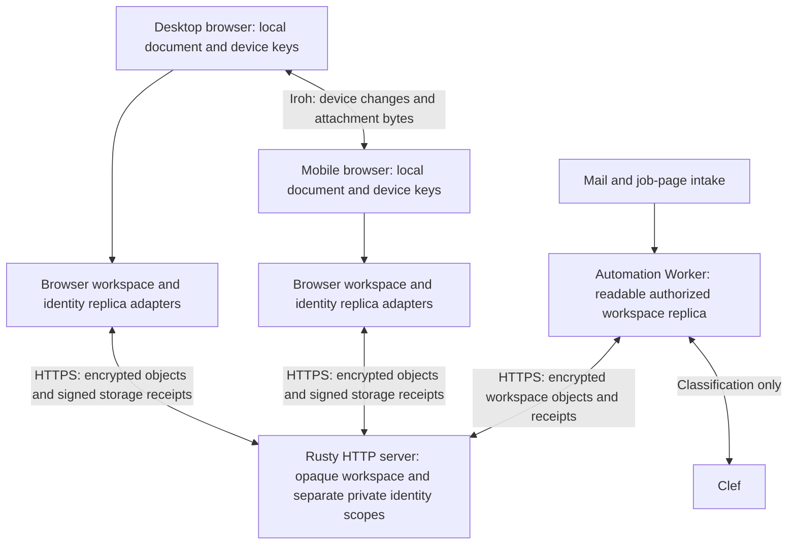
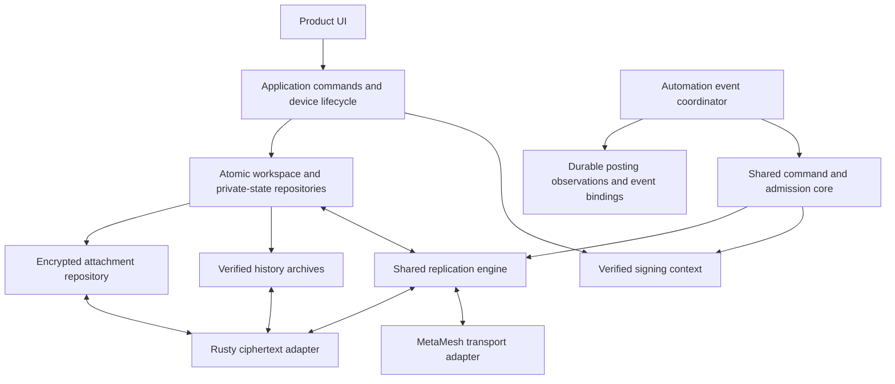

> Historical release model: the coordinated rollout and cross-service cohort
> described below are superseded. Current deployments and recovery are owned by
> each service's pipeline; see [current architecture](../../../docs/architecture.md)
> and [independent platform boundaries](../independent-platform-boundaries/design.md).

## Audit Baseline

These nine findings describe the inspected baseline before this change, not the
completion state of the current source. This file specifies contracts; it does not
report live release readiness. Named execution evidence belongs in CI artifacts and
`verification-map.md`; release completion is defined in `tasks.md`. The concise
[current architecture](../../../docs/architecture.md) distinguishes implementation,
scenario execution, deployed artifacts and the user's actual phone.

| Finding | Baseline source | Observed defect or architectural risk |
| --- | --- | --- |
| 1 | `src/sync/enrollment.ts`, `src/app/identityPhoto.ts`, `src/chat/service.ts` | Enrollment had stripped photo; private Rusty settings had stayed device-local. Transfer paths require separately maintained schemas. |
| 2 | `src/sync/deviceEnrollmentDelegation.ts`, Rusty `src/blind.rs::trusted_controller_device` | Same-person ownership differs from controller ancestry; old devices need certificate repair through a root-key holder. |
| 3 | `src/sync/changeAuthorization.ts::recordGenesisAuthority` | Creating a workspace on a delegated device failed with a leaf-only certificate; repaired in the baseline release. |
| 4 | `src/sync/identityDevicePreferences.ts` | Preference registry and effective configs are separate writes; wall-clock ordering can dominate later edits. Crash divergence is a code-established risk, not a reproduced production incident. |
| 5 | `src/sync/blindReplication.ts`, `workers/automation/src/replica.ts` | Two replica orchestrators; Worker constructs and hashes complete outgoing state before unchanged-state detection. |
| 6 | `src/sync/blindReplication.ts::prepareCheckpointState`, `docs/architecture.md` | Storage checkpoint reduces object count but keeps full inner history; cold reads still grow with history. |
| 7 | `src/sync/durableMeshSessions.ts::fetchBlob` | Private attachment bytes depend on direct peers; CI reported a closed runtime node during preview. Root cause of that closure remains unestablished. |
| 8 | `workers/automation/src/applicationMatching.ts` | Current page titles replace card Role matching, but no persistent posting observation or explicit ambiguous-event binding exists. |
| 9 | `.github/workflows/deploy-frontend.yml`, Rusty CI | Independent releases and cached tabs can expose incomplete capability combinations. |

## Current Working-Tree Boundaries

Rusty is already a client-server HTTP storage service. Private board application
logic stays on devices and the explicitly approved automation Worker. Rusty does
not receive private content keys or application edit authority. Browser and Worker
HTTPS replicas use the shared `ReplicaEngine`; Iroh device synchronization remains
a distinct transport/protocol path. Same-person identity state, including signed
profile/photo state and portable Rusty access, has a separate encrypted scope.
Every device retains its own local cursor and outbox. Product preview/download
now tries retained encrypted Rusty locators before device transfer. Real current
workspace/device rights guard those reads and their fallback. Native HTTP checks
cover the production read adapter with source access unavailable. Normal replica
push now discovers workspace file descriptors and schedules encrypted upload or
cold-coverage confirmation. Existing files do not gain Rusty coverage merely
from the reader. Credential transitions, bounded streaming and session recovery
have source paths and named scenarios; their execution and rollout require the
separate evidence defined in the acceptance map.

Public board publication is a separate readable namespace served by Rusty. It is
not a decryption path into private scopes. This diagram describes inspected source,
not proof of the deployed release or browser/mobile acceptance.

## Target Boundaries

Shared code owns protocol behavior, admission, revisions, durable-outbox semantics
and receipts. Adapters own IndexedDB versus Durable Object storage, worker execution
and network I/O. UI consumes product states and does not assemble certificate chains,
guess ownership, decrypt transport state or select historical verification shortcuts.

## 1. Complete Device State

Define a versioned `IdentityDeviceState` manifest for identity catalog, profile
observations, entitled workspace references, private service connections, owner
capabilities and supported schemas. Every durable same-identity state component
must declare its transfer schema and migration. Enrollment and later synchronization
use the same codec; unknown required components block completion with an upgrade
state rather than silently disappear.

Private service credentials travel only through an authenticated same-person
channel or an explicitly authorized encrypted recovery package. Shared workspace
documents, other-person invitations and public projections exclude them. Keys
and local cursors are distinct: replicating a credential must not replicate a
device's upload acknowledgment or remote inventory cursor.

Migration cannot recover a missing secret from a public certificate or a hash.
A legacy phone that never received a content key needs an existing key-holding
device or a valid recovery package once. That holder need not be a privileged
primary device. After migration, operations must not depend on its availability.

Recovery uses the same manifest as enrollment and later private synchronization.
The `tincanban-identity-device-recovery@1` JSON package carries an existing v3
words-wrapped root envelope and AES-GCM ciphertext of the complete manifest.
HKDF-SHA256 derives a separate key from the recovered root with a random 32-byte
salt and `tincanban/identity-device-recovery/v1` context. Authentication binds the
exact package header, including the wrapped root, person, version, salt and IV.
The bounded reader verifies the embedded device chains, profile state and service
capabilities before adopting any state. Identity/profile/catalog/private credentials,
backup of the replaced profile and activation intent commit in one local CAS.
Certificate publication and workspace profile projection resume after restart.
Same-person root-key import preserves the active device; cold recovery issues a
fresh root-certified device. Existing seed-only files remain readable and are
identified as identity-key-only, never treated as complete state. Neither package
includes device private keys, local replication progress, board history or attachment
bytes. Workspace references and credentials are not proof that those bytes still
exist on a reachable Rusty; separate workspace backups remain necessary.

Workspace profile observations have two distinct admission boundaries. The private
same-person manifest validates the original profile signature, complete author
chain, exact person/root key and declared workspace reference; it does not treat
the record's unsigned `authority` wrapper as proof of workspace ownership. The
signed payload binds a chat-room scope, which can differ from the document ID.
Without the installed workspace, the receiving device atomically retains the
observation in a person-bound projection queue and continues the remaining
identity import. The profile component writer advertises `profile-observations@3` and carries the signed causal profile state with the name/photo presentation shadow; transfer readers validate the shadow against that state. `@1` and `@2` remain readable as original legacy observations without manufactured signed revisions.

Shared-profile projection resolves the actual installed document's current chat
scope and authority, verifies the original record through normal workspace access
checks, and confirms durable chat storage before removing the queued observation.
Projection never installs a workspace owner, grant, credential or document. Missing
workspace state, changed/revoked authority, signature or scope mismatch, storage
failure and stale identity leave the record retained for retry. One unavailable
workspace does not prevent later identity bundles. Queue activation participates
in the same compare-and-swap as catalog, credentials, recovery and adoption;
projection is an idempotent, restartable secondary effect. Queue limits fail
explicitly without replacing previously retained bytes.

The target gives a person one authoritative causal name/photo register, separate
from workspace chat profiles. Legacy `changedAt` timestamps are metadata, never
causal order. Migration retains incompatible values as candidates without minting
a revision; only explicit local save creates causality. Concurrent values stay
visible as a conflict until a user sees both and saves a resolution. Workspace
profiles affect only their scoped chat projection, not the private register.

The causal model in `src/domain/identityProfileState.ts` now has eight reported
real-crypto tests covering signed per-device counters and contexts, complete
certificate verification through `VerifiedSigningContext`, immutable operations,
exact-hash legacy values, supersession, conflict retention, explicit resolution,
field-reference validation, forged signatures, equivocation and newer unsupported
state. Current caps (512 operations, 512 legacy values, 1 MiB) are model input
bounds, not the architecture's history/checkpoint policy. The model is embedded in `PersonalRootDocumentV1.profileState`, carried by the `profile-observations@3` transfer component and checked against its presentation shadow. The name/photo save path uses signed causal operations. Workspace shared-profile projection remains separate and must not mutate the private register. The acceptance map identifies conflict-resolution scenarios.

`saveIdentityName` now signs causal name/photo operations and commits both values,
the personal-root projection and candidate `local_profile` under one
compare-and-swap conditioned on the captured profile revision. A storage abort or
stale/CAS-lost draft preserves exact previous bytes; stale saves require review.
One preference event publishes only after commit. Five focused cases in
`src/app/identityProfile.atomic.test.ts` cover commit, abort, stale revision, CAS
race and no-op save; existing SDK rename/refresh and async root-planner cases are
supporting evidence. The transfer compatibility tests verify the @3 state/shadow
contract and native cold-photo test now uses the production photo writer.
`e2e/identity-profile-conflicts.spec.ts` covers combined-save, conflict and stale-draft
scenarios, including pending-revision loading. Execution evidence is scenario-specific. Current
activation preflight validates the local profile identity and its private signing
key bytes before non-adoption writes; missing profile/key or a mismatch requires
restore and cannot create a new profile as a side effect. The captured raw profile is also supplied as `expectedRaw` to SDK refresh, binding presentation publication to the exact bytes activation validated. Missing/malformed storage and a concurrent replacement fail closed; no new identity is generated. Eleven focused SDK presentation-refresh checks pass; four pre-existing findings remain in SDK index lint, so no clean index-lint result is claimed.

The working tree contains the projection queue, author-only observation verifier
and current-workspace projection path. The queue retains at most 512 unique
observations and 1 MiB, and its import joins the same identity activation CAS.
`src/chat/records.ts::verifyChatRecord` returns a detached admitted record;
projection resolves the signed chat scope from the installed document, checks
current authority/revocation under the workspace mutation boundary, confirms
durable storage, and only then acknowledges the exact queue item. The outer
manifest reference is a document ID; the signed profile's chat scope can differ.

Reported focused evidence: `src/sync/identityProfileProjection.test.ts` (13),
`identityProfileProjectionQueue.test.ts` (7),
`src/chat/privateProfileObservation.test.ts` (7),
`src/sync/identityDeviceActivationLoader.test.ts` (7) and
`src/app/useIdentityProfileRecovery.test.ts` (4) passed. Coverage includes
author-only validation, no authority from the wrapper, absent-workspace retention,
later current-scope projection, stale/revoked/mismatched scope, durable confirmation,
retry, queue limits and identity guards. Three reported native HTTP cases include
cold Rusty delivery of the original signed profile into an initially empty private
queue while source capture is unavailable. Because the referenced workspace is
unknown, this demonstrates transfer and deferred retention, not shared projection.
After the full app
run, the final codec-alias refactor was followed by a 44-case focused four-file
run. Those historical focused results do not establish compatible old-reader behavior,
product diagnostics or the complete requirement. Current browser and release evidence
must be read from the acceptance map and exact CI artifacts.

Current working-tree evidence: `identityDeviceStateCodec` writes required
`private-rusty-connections@3` and accepts `@2` only as legacy workspace state.
The private preference writer emits wire v3 with explicit `workspace` or
`identity` purpose; v2 reads normalize only untagged workspace records. Identity
credentials have no synthetic workspace ID, and their owner must match the
manifest person. Portable preferences omit cursor, acknowledgment, pending upload
object and replica progress. The ordinary device-sync loop now provisions a
separate identity scope for existing board-only Rusty origins, runs identity
replicas before workspace replicas, and reloads preferences in that pass. Setup
credentials persist before network enrollment; confirmed policy/storage enrollment
activates the private connection against the exact current profile, imports private
state and removes the setup intent in one compare-and-swap transaction. Tombstones
and conflicts prevent automatic re-addition, and setup failures remain distinct
from board health.

Seven setup tests, eight scheduler-loop tests and three native HTTP integration
cases cover this working-tree path. Native tests exercise Rusty policy/storage HTTP,
person-policy bootstrap, independent same-person device scope creation after
controller pins are removed, and cold profile-photo plus opaque optional-component
pull while source capture is unavailable. The recipient extension state is cleared
before the pull and the exact component is checked after re-export. They do not
prove browser or deployed-device delivery. The first
person-policy migration still requires the configured legacy controller; after
confirmation, later scope creation requires the exact parent capability/revision
and no controller ancestry. Unknown optional device-state components now have a
separate opaque retention registry: variants are validated, sorted/deduplicated,
merged without a clock winner, included in the activation compare-and-swap, and
exported on the next manifest. A newer registry layout requests upgrade without
replacing its bytes. Thirteen focused tests are reported passing for roundtrip,
conflict order, abort/retry, newer-state retention, privacy bounds and cross-tab
CAS, including mutation of the original manifest identity during an awaited storage
read. This is logic evidence, not proof of rollout to older deployed readers.
Workspace installation uses restartable recovery projections; approval migration
and causal name/photo state have separate contracts and acceptance obligations.

The optional carrier is `preservedExtensions`, schema
`preserved-identity-components@1`, with `required: false` and a person-bound list
of `{name, component}` variants. Local storage uses
`tincanban.identity-device-extensions.v1.<person>`. Import unions exact validated
variants, canonical-sorts and deduplicates them without timestamps, caps the set at
256 unique variants and stored JSON at 1 MiB, and commits the plan with the rest of
device-state activation. Export emits the retained variants on the next manifest.
Required unknown components still request upgrade; optional raw-key fields,
required-state smuggling, malformed components and person mismatches fail closed.
A future preservation-container schema is retained as an opaque variant rather
than decoded or nested. A newer local registry format remains byte-for-byte intact
and blocks overwrite with upgrade-required. Thirteen focused tests are now
reported passing, including mutation of the source manifest identity during an
asynchronous storage read. These tests establish current logic behavior, not
compatibility with older deployed readers.

## 2. Consistent Authority

Content-key retention is explicit in private replica credentials. Active
`keyEpoch`/`contentKey` selects the writer key; `historicalContentKeys` stores
unique old keys. `historicalContentKeyVariants` stores bounded, canonical,
deduplicated candidate arrays when different old keys share an epoch. The maps
cannot overlap. Authenticated snapshot, identity, attachment and history readers
try the ciphertext epoch's retained candidates; no string ordering chooses the
meaning of an encrypted object. Missing keys fail before admission or cursor
acknowledgment. Every causal successor retains every candidate per epoch.

Ambiguous history requires private wire5 and required identity component
`private-rusty-connections@5`; the Worker storage reader is version4. Releases
advertise these actual reader floors. Older supported formats remain readable
only without hidden variant fields. Unrotated and unique-history state keep their
older compatible wire shapes.

An explicit Owner recovery proposes fresh independent tokens and an active key
at max observed epoch+1. It captures exact causal source and original outbox,
freezes ordinary origin writes and every approved Worker, then uses the signed
current service revision for scope-policy CAS. Original pending ciphertext and
request ID replay unchanged with confirmed fresh transport credentials; signed
receipts and uncertain requests remain in the restartable journal. Frozen Workers
receive the retained key set before causal activation. Completion needs a fresh
snapshot receipt; the completed journal remains immutable audit evidence. No data
is deleted, no timestamp supplies authority and no conflicting key is discarded.
Source implementations include the shared exact-source repository activation,
controller forwarding and restart-visible recovery action. Logic, Worker receiver
and UI scenarios are mapped separately from production activation.

Rusty's `scopeEnrollmentRetry@1` capability preserves the latest completed
enrollment receipt and normalized request hash in the same atomic scope-policy
write as token MACs. No bearer token is persisted. An exact authorized retry can
return the original signed receipt after challenge cleanup or restart, including
an expired challenge only when this exact policy was already committed. Current
person/resource/device authorization, original signatures, token hashes and exact
policy revision still apply; substituted requests or superseded policies cannot
reuse that receipt. A retry reasserts directory durability after a failed fsync.
The browser persists the exact signed enrollment body before its first mutation
when this capability is advertised. Its device-local journal is excluded from
identity transfer. Changed tokens/device/service pin/revocation/writer floor,
corrupt signatures and capability downgrade cannot replace a pending request.
Receipt or activation-callback failure retains it. Successful retry validates
the original signature, current profile, current management authority and exact
service receipt before clearing the intent. Callers can require this capability
before any enrollment or management mutation.

A never-committed expired request first retries its original body. Only after a
410 response can a fresh signed challenge replace it, and only when its policy
revision is unchanged and the server's signed issuance time is at or beyond the
old expiry. That proves the old request cannot now commit. Revision/time conflict
retains the original intent; one call makes at most one such replacement. Full
credential rotation still needs the durable freeze/drain/activation journal and
approved automation maintenance path.

`replicaCredentialFreeze.ts` now persists one device-local person/origin transition
before any server mutation. It captures every current pinned workspace/identity
scope, the target device, and freshly generated future epoch/key/tokens exactly
once, retaining all older keys. CAS includes the exact current profile, private
repository and legacy inputs. Conflicts, removal, a pending writer upgrade, a
different target/service/signer or changed source block preparation. The journal
is not portable identity content. Ordinary progress, credential edits, changed
portable imports, late legacy reconciliation and writer-policy transitions check
its exact storage key in their transaction; unrelated origins remain independent.
`replicaCredentialDrain.ts` is the maintenance exception: it binds the original
resource and exact journal, then gives the shared engine only the saved outbox and
upload/receipt ports. It has no capture, inventory, seal or admission path. These
are preparation and drain components of the complete transition. Person revocation,
receipt retention and all-scope activation remain mandatory conditions of the
exposed device-removal operation, not optional consequences of a successful drain.

Worker maintenance has separate signed `prepare-storage-rotation` and
`rotate-storage` actions. Preparation pulls current authority, drains its exact
outbox and durably freezes execution in the serialized integration queue. Queued
events remain saved. Rotation requires the exact transition, same pinned scope,
one newer key epoch, every retained old key, new tokens and a newer signed Rusty
policy receipt. It preserves the original grant, expiry, definition, document,
events, chat, attachments and cursor; it never renews approval or re-encrypts an
uncertain snapshot. Current authority is reacquired using the new access before
atomic replica publication and freeze removal. A bounded latest-completion marker
allows a fresh signed request to recover a lost response. Client helpers verify
the signed public storage/freeze acknowledgment. HTTP/DO failure/race acceptance
is being authored; no verification has executed. The browser transition controller
must still coordinate these phases before changing any scope token.
The rotation identity acknowledgment confirms installed credentials, not a newly
uploaded snapshot. Expired, paused or deleted Worker approval is not made
executable by maintenance. Its upload acknowledgment is invalidated so a later
normally authorized sync must use the new epoch. The browser controller must
separately obtain its own fresh-epoch receipt before reporting the full transition
complete.

The shared replica engine exposes `drainPending()` for this transition. It retries
only already persisted ciphertext/request IDs, verifies the receipt and commits
acknowledgment under the current binding. It does not read local content revision,
capture/hash/seal new state, prepare attachments or fetch inventory. New local
changes remain for a later normal push under the new epoch. Browser workspace and
identity adapters expose the same operation. Worker management inspection also
exposes it behind a caller-supplied current Owner guard and admitted-state check;
historical grant inspection does not renew the grant or create new content.
The extended policy record requires the compatible Rusty rollback reader in the
final release cohort; older `deny_unknown_fields` readers cannot open it.

Initial board setup now retains complete random scope/key/token credentials in
`workspaceReplicaConnection.ts` before enrollment. Its confirmation callback saves
the original signed receipt and activation stage before the exact-request journal
can clear. Activation publishes private preferences and removes the setup record
in one CAS conditioned on original setup/profile/private-state bytes. Failed
approval, receipt persistence or activation keeps the same credentials for retry.
An already activated competing scope or removal of the pending scope prevents
automatic resurrection. Explicit Connect may create a new opaque scope after
removal while retaining the old tombstone; background-style setup does not.

### Person policy and creation of new resources

The remaining first-resource ancestry dependency is closed with a separate
`person` management resource, whose ID must equal the approved root person ID.
It uses the same atomic policy/audit/status machinery as scope and board policies,
with a distinct `rusty-person-management-capability@1` discriminator and exactly
`management.update` / `resource.create` operations. Discovery advertises
`personManagement.version: 1` separately. One initial, explicit migration retains
operator-approved controller proof; after its confirmation, every non-revoked
certified device of that person can use those explicit rights without the original
controller being online or present in its certificate ancestry.

Existing connections expose that migration through **Sync → Rusty → Update device
access**, with its same-person scope explained beside the action. Background
profile setup and identity synchronization return a typed action-required state
when no person policy exists; they cannot create a fresh legacy migration.
Connecting a new Rusty is an explicit owner action and may establish its initial
person policy. A saved authorized policy request may recover through a fresh
signed status or its exact retry without asking the owner to authorize it again.
The app keeps the service pin, scope, bearer credentials, content key, local cursor
and current device certificate unchanged. It rechecks current workspace ownership
and the exact saved connection revision around migration. Private preference
exchange no longer generates or installs a controller-delegated replacement
certificate; an obsolete signed `delegation` extra is inert data and cannot gain
authority or enter the proof store.

A first scope/board policy request presents `personManagementCapability` and binds
its exact `personManagementRevision` inside the signed update. A stale/substituted
capability, another person/origin/service, removed creation operation or revoked
device cannot create a resource. Creation yields its own resource capability;
person authority cannot bypass an existing resource's operation restrictions.
New-resource requests retain the original person capability in immutable audit
evidence. Existing evidence and original signatures are not rewritten.

The confirmed person policy supplies cumulative device revocation to every
management/status/publication/checkpoint/enrollment path. A pending person-policy
transition stops resource management; its authenticated status and exact policy
retry remain available so interruption is recoverable. Once a person policy is
pending or confirmed, controller pins cannot authorize unmanaged resources or
bypass revocation. Global management revocation does not retroactively erase
plaintext or invalidate disclosed storage bearer credentials: rotating future
content keys/tokens is a separate required implementation and release task.

Acceptance covers two unrelated root-issued device chains creating new scopes
after operator pins are removed, wrong/old person evidence, operation restriction,
revocation across existing scopes and boards, lost policy replies, pending-pointer
faults, restart, immutable audit integrity and reader upgrade behavior. This is a
target contract. Current partial implementation covers the separate person
capability and discovery bit, one-time controller migration, parent capability plus
signed revision on resource creation, and current person-revocation checks across
resource management/status, publication challenge/staging, checkpoint and
enrollment. The client exposes `ensureRustyPersonPolicy`, binds new resource
requests to exact parent evidence, and checks current person status before identity
replication. A native HTTP case restarts the same Rusty volume at the same origin
with controller pins empty, then creates a scope from a distinct root-issued
same-person device without its root private key. The server suite includes
pending-policy status/retry after restart and global revocation cases. These are
scoped implementation results, not full requirement or product proof.

Current person revocation enforcement is implemented in the service and
identity-replication client. Explicit migration/revocation UI, typed background state,
future credential rotation and certificate-stability cases have source paths and
named scenarios. Their presence does not establish rollback compatibility or a
production rollout; those require the separate final evidence.

Separate `DeviceIdentityProof` from explicit `ScopeManagementCapability`.
Certificate chains prove the caller's device belongs to the trusted person.
Management capability binds person, service, scope/board, allowed operations,
policy revision and revocation state. Enrollment ancestry must not grant or deny
management independently of that capability.

All non-revoked devices of an approved owning identity have the same ordinary
product rights for the approved scopes. An unrelated person, a revoked device,
an unrelated certificate appended to a bundle or an old policy revision grants
nothing. Existing operator approval, service identity pinning and scope boundaries
remain enforced. Rusty never receives plaintext board authority merely to verify
a ciphertext-management request.

Legacy controller pins migrate through a validated, explicit owner-policy update.
Until confirmed, the UI shows migration pending and existing data stays readable;
neither a settings import nor a new certificate silently overwrites server policy.
Future-content key rotation remains separate from revocation of management rights.

Concrete Rusty wire: `rusty-scope-management-capability@1` is a service-signed
`RUSTY/2` envelope binding `serviceId`, `origin`, `personId`, `resourceKind`
(`scope` or `board`), `resourceId`, positive `revision`, explicit `operations`,
and a monotonic `revokedDeviceIds` set, plus `requestId`, `authorizationHash` and
`issuedAt` covering the confirmed update. It contains no transport credentials or
application grants. A valid owner certificate proves device identity only.
After a resource migrates, ordinary management requests must present its exact
current capability; missing/stale capabilities never fall back to legacy pins.
Enrollment, checkpoint, publication and public-file commands additionally bind
`managementRevision` inside the device-signed authorization. Replacing only an
outer capability cannot authorize an older signed command.

`PUT /v2/management/{kind}/{id}` carries a `MATCH/1` device-signed
`rusty-management-policy-update@1`: exact service/origin/person/device/resource,
expected revision, operations, cumulative revoked-device IDs, request ID and
short issuance/expiry window. First revision requires legacy operator-approved
controller proof. Later revisions require current `management.update` authority.
CAS and immutable request evidence prevent replay/rollback; the exact last
completed request returns its prior receipt across loss/restart. The capability
is authenticated management evidence, not a storage bearer secret.
`POST /v2/management/{kind}/{id}/status` requires a current owner device's complete
proof and short-lived `rusty-management-policy-status@1` signature over exact
service/origin/person/device/resource/request ID/times. Status nonces are durably
single-use; unsigned reads, other people and revoked devices receive no capability.
The service-signed status receipt binds the request, capability hash, current
revision and pending state, preventing replayed status from appearing current.
Service storage atomically publishes its current pointer after immutable policy
evidence is durable. Older policy evidence and encrypted scope data are retained.

Client authority is stored separately from storage credentials in one per-person
atomic `tincanban.rusty-management.v1.<person>` record. Each resource retains its
pinned service key, highest verified capability and any exact pending signed
policy request. The repository permits at most 256 resources and 8 MiB UTF-8.
It validates current stored evidence before replacing the complete record through
compare-and-set; a failure cannot advance authority or erase intent. A lost reply
retries the exact pending body, including after expiry when Rusty can confirm a
completed request. A fresh signed status or authenticated peer capability can
clear intent only when request ID, full authorization hash, expected next revision,
operations and cumulative revocations match. Superseded unmatched intent stays
pending for owner review. Portable `ownerCapabilities` state contains capabilities
and pins, never local pending requests. Imported bundles validate completely before
one transaction; stale peer evidence cannot replace fresher local policy, same
revision contradictions fail closed, and signed revocations persist even on the
revoked device. Imported evidence must be confirmed by signed service status before
being treated as current management authority. These contracts complement the
identity-manifest backup/restore flow; neither one alone proves board/file recovery.

## 3. Verified Signing Context

Provide one resolver returning an opaque `VerifiedSigningContext`, bound to person,
device, complete validated chain, requested scope, authority revision and purpose.
Signing accepts that context instead of separately supplied keys/certificates.
Genesis, commands, chat, enrollment, public publication, checkpoints and automation
owner requests use the same resolver. Historical verification retains historical
evidence; current signing resolves current authority.

Context validation does not create or broaden authority. Identity replacement,
device replacement, revocation, policy change and grant expiry invalidate affected
contexts. A missing ancestor must produce a recoverable missing-evidence state,
never an unsigned fallback or assumed Owner role. New core APIs must prevent a
bare leaf certificate from masquerading as a complete proof bundle.

Current command producers use `transactionProofs.ts` and the same opaque context
for actor bindings and change proofs. The browser persistence/review adapters bind
both proofs to one captured authority revision, rechecking current workspace
capability while signing. Worker command proofs resolve against its own live
Automation grant, admitted workspace authority, lifecycle and expiry; they never
consult a browser-local profile store. Ordinary browser commands without an
explicit host context require the active durable local identity. Historical test
authors supply explicit separate host contexts rather than replacing that identity.

The browser resolver compares durable identity/device/certificate and encoded key
material around signing. Exportable local PKCS8 encodings are cached by immutable
`CryptoKey`, so a changed saved key cannot reuse a context merely because public
metadata remained equal. Chat record construction requires an explicit context;
its live producer rechecks scope, owner, grant, revocation and active profile, and
does not treat failed authority reads as empty authority. TinSink approval uses the
same resolver under its unchanged `TINSINK/1` login wire and rechecks the exact
opener, request and deadline immediately before returning approval to that origin.

Workspace genesis and workspace-change proofs now use `workspaceSigning.ts` to
compose the durable local signer with current Native workspace policy. Genesis
requires current Owner authority; a revoked device/grant or conflicting authority
cannot sign. Workspace-change checks use the already-admitted dependency view for
an ordinary single-head write, preserving the incremental access cache instead of
replaying the new document's entire history. Explicit host contexts must match the
captured author and cannot bypass the producer's post-signature authority check.
The default enrolled-browser genesis path works without an identity private key.

Enrollment requests and certificate issuance now use the local resolver. The
certificate binding names the recipient device/key, while signer evidence names
the issuer. Approval consumes the current invitation through a synchronous
compare-and-set over its stored object, immutable fingerprint, claimant, status
and finite future expiry. Cancellation/replacement after the final asynchronous
check cannot produce a successful approval. Invitations remain in-memory; this
does not add a durable invitation journal or finish enrollment recovery.

Same-person preference exports bind the active durable key and session throughout
signing. They capture the author before asynchronous work, acquire shared metadata
before the final signature, and return no packet if that work changes the active
identity. Legacy Keeper controller requests use the same resolver with their
unchanged `MESH-LIGHTHOUSE/1` domain and seconds-based wire timestamps; local
context expiry converts those timestamps to milliseconds. Full evidence comes
from the verified context rather than a device-ID-deduplicated certificate pool.

Automation renewal verifies the previous contract under the historical owner
derived from the fully admitted ownership chain. Only the current, non-revoked
owner device may issue a replacement approval. Historical signature validity does
not restore expired execution rights. The verified-context contract applies at each
producer boundary; a passing renewal scenario cannot certify other SDK or raw-key
callers. Producer coverage is an explicit acceptance obligation.

## 4. Transactional Private Preferences

Initial local migration now compares both raw legacy stores in the same CAS that
publishes the authoritative private record. Concurrent old-tab writes cause a
fresh read and retry. Divergent same-scope settings and registry values become
concurrent candidates, including duplicate variants within either source;
timestamps never imply that one superseded another. A removal dominates without
discarding retained original legacy bytes. Identical credentials with divergent
local cursors resume from the earliest cursor and reset a conflicting upload
acknowledgment. Conflict summaries expose only origin, scope and affected subject
metadata; the UI shows paused delivery without sending credential values into
presentation. Migration, races and browser behavior have separate acceptance
scenarios. Explicit conflict-recovery source retains every
same-epoch key and exact original outbox through the dedicated origin freeze,
signed scope-policy CAS, shared activation and restart-visible Owner action.
Their source presence does not establish an executed scenario or deployed behavior.

Replace the registry/effective-config pair with one authoritative transactional
record containing portable credential state, durable tombstones, version vector
or logical revision, and separate per-device replication progress. Effective
configurations are projections, not a second durable source of truth.

Use per-device logical counters and causal merge rules, not physical clock
precedence. Concurrent remove/update remains explicitly removed until a later
causal re-add; ordinary reconnect must not resurrect a removed service. Different
concurrent credentials for one scope produce a resolvable conflict, not arbitrary
selection by string ordering. Retain tombstones until acknowledgment or a validated
state checkpoint proves they are no longer needed.

Concurrent observations with identical resource bindings, service pin, keys,
tokens, retained key history and removal state join the maximum policy revision
and writer floor. These fields are monotonic storage metadata, not different
credentials; their disagreement alone must not trigger key rotation. Keep the
original causal operations so merge order and restarts do not invent precedence.
Different keys, tokens, subjects or pins still stop replication for review.

Key activation retains the download cursor and reading keys, but clears all upload
confirmation shortcuts, including content identity. A confirmation under an old
key cannot satisfy the required new-key snapshot. The recovery panel publishes
repository conflicts and unfinished journal summaries together, preserving its
pending action and failure across asynchronous reloads. The mobile WebKit scenario
`e2e/rusty-credential-conflict.spec.ts` uses a real Rusty, rejects the replacement
snapshot upload, reloads the browser, retries the saved request and verifies the
board and old reading key remain available. Recovery failures emit the
`rusty.credential-recovery` diagnostic operation without credential values.

Migration reads both legacy keys, writes a complete new record and migration marker
in one transaction, then switches readers. Do not erase old records before verified
restart recovery. A cursor commit requires the exact credential revision it used.

## 5. Shared Replica Engine

Use one replica state machine for browser and Worker: inventory, bounded download,
decryption, admission, durable merge, progress commit, outgoing change construction,
encryption, durable outbox, upload and exact signed acknowledgment. Hosts supply
repository, transport, signer, clock/scheduler and event adapters. Automation remains
a restricted author; it does not inherit Owner powers from using shared code.

Expose repository revisions for document, authority, chat/profile, archive and blob
manifests. Unchanged polling must avoid reading/serializing/hashing historical
payloads. Changed state transfers verified deltas or bounded baseline segments;
complete export remains an explicit operation. Lost responses reuse exact durable
ciphertext. Cursor/ack advancement follows durable admission/receipt confirmation.

Progress, admission and UI publication share a documented commit boundary.
Partial chat/blob coverage cannot be reported as complete workspace coverage.
Delete obsolete parallel orchestration only after both host adapters satisfy the
same contract tests.

The current identity host adapter uses this engine with purpose-bound encryption
and a signed same-person state record. The ordinary sync loop provisions it for
existing board-only Rusty origins and reports setup failures separately. This
establishes a typed, provisioned identity transport path, but not complete global
authority/bootstrap behavior or browser/device acceptance.

## 6. Active History and Archive

The [history archive contract](history-archive-contract.md) specifies the concrete
record boundaries, bounded catalogue/index shape, bootstrap trust, activation
transaction and old-basis/offline-edit recovery requirements. Browser and Worker
producer/receiver paths, atomic activation, lazy archived history and private
recovery now exist in the working tree. The document describes their contract;
it does not establish final acceptance or production capability activation.

Distinguish an opaque storage checkpoint from an authorized document-history
baseline. The former prunes redundant ciphertext copies; the latter bounds active
Automerge history. They have different types, validation and UI evidence.

Implement a versioned owner-authored baseline transition in shared Rust policy.
It binds workspace, authority/control epoch, covered causal frontier, prior baseline,
active state digest and archive manifest root. It is an explicit new authorized
transition, not a declaration that old invalid writes became valid. It cannot
change owner/grant/revocation semantics or invent historical authorship. Automation
and storage peers cannot author it. Pending/quarantined history stays classified
and preserved; it cannot silently enter the baseline's admitted state.

This changes the bootstrap trust contract: a receiver verifies the owner-authorized
baseline under the checkpoint policy, then verifies every subsequent change.
Historical authorship and prior admission can be independently reconstructed from
authenticated archives. This trust decision and its attack cases must be documented
and tested in policy before a receiver accepts network baselines. A signed local
admission cache is never promoted into a portable checkpoint.

Archive original changes, proofs, receipts, authority evidence and classification
provenance in immutable content-addressed segments with a verified manifest and
lazy history index. A pre-compaction recovery copy and exact durable archive receipts
must exist before replacing an active basis. History restore creates a fresh signed
command; it does not rewrite the archived original. Bundle export includes verified
archives or explicitly reports incomplete recovery coverage.

Default baseline trigger: 512 admitted active changes or 4 MiB of active history,
whichever occurs first. Validation may adjust these defaults from measured limits,
with evidence in this change. Reaching this trigger never blocks admission of
valid remote changes. Automation pauses new authored changes until the Owner
baseline completes, while synchronization and guarded management remain available.
Cold restoration derives usage from the admitted document and verified baseline;
legacy fallback counters cannot establish that the trigger was reached.
Bootstrap and ordinary commands scale with current
state plus bounded tail, not lifetime edit count. Archives and current content can
still consume increasing total disk space; quota status, capacity failures and
optional retention must be explicit. No automatic destruction of historical data.

## 7. Attachments and Transport Lifecycle

### Separate immutable blob namespace

`PUT/GET /v2/scopes/{scope}/blobs/{ciphertextId}` stores opaque manifest/chunk
objects separately from `/objects`, using the same existing read/write storage
tokens and revocation policy. The server does not inspect plaintext or application
permissions. `ciphertextId` is SHA-256 of canonical encrypted-object JSON, never
the plaintext file digest. Snapshot inventory and checkpoint deletion never list
or delete blob objects. Public files remain in the separate publication namespace.

Discovery advertises `encryptedBlobs: {version: 1, maximumCiphertextBytes: 1048592}`.
The unchanged opaque object-v1 shape binds scope and key epoch; client-side AAD
additionally binds attachment purpose/subject/index/count. The client codec's
chunk size is 256 KiB; Rusty's ciphertext cap is 1 MiB plus the 16-byte GCM tag.
Encrypted manifests contain filename, media type, length, private content digest
and ordered chunk references. No filename/content digest belongs in an HTTP path,
service receipt or diagnostic attribute.

Successful writes return a `RUSTY/2` signed
`blind-blob-storage-receipt@1`, binding service ID, scope, key epoch, ciphertext
object ID, current policy revision and request ID. It has no snapshot sequence:
file coverage is independent of the document replication cursor. Both uploads
and reads prohibit response caching. Identical retries revalidate existing bytes
and fsync the namespace before acknowledging; a failed fsync issues no receipt.
The new namespace's parent link is fsynced before acknowledgement, preserving
durability across first-write restart.

Snapshots and blobs share the configured per-scope byte quota. A namespace allows
at most 16,384 blob objects; capacity failure is HTTP 507, missing authorized
objects HTTP 404, denied access HTTP 403 and storage/integrity failures HTTP 503.
Existing snapshot checkpoint accounting includes retained blobs and scratch use;
it cannot free blob capacity by deleting files. There is no implicit blob garbage
collection. A future deletion/retention policy must preserve referenced/history
coverage and receive explicit authorization.

### Read-only blob coverage proof

`POST /v2/scopes/{scope}/blob-coverage` is a separate read-only proof over a
bounded exact batch. Discovery advertises `blobCoverage: {version: 1,
maximumObjects: 33}` independently of `encryptedBlobs`; blob storage support alone
does not promise coverage proofs. The request uses the scope read bearer and an
exact version-1 body containing a URL-safe 20–64-character request ID and 1–33
objects sorted by unique ciphertext object ID, each paired with its positive key
epoch. The request is limited to 16 KiB. Unknown fields, duplicate or unsorted
IDs, unsupported versions and invalid epochs fail closed.

For every requested object, Rusty checks the committed bytes against the
ciphertext ID and expected key epoch, then fsyncs the blob namespace before
signing a `RUSTY/2` `blind-blob-coverage-receipt` bound to service ID, current
policy revision, scope, request ID and exact object set. The endpoint does not
write or disclose blob bytes, plaintext metadata, content keys or application
grants. A known encrypted locator is only a pointer; it is not evidence that all
referenced ciphertext still exists durably at Rusty. A client may claim complete
Rusty coverage only after verifying a receipt for the exact manifest and chunk
set. Older servers without the separate capability provide no cold-coverage
proof.

Rusty's full suite passes 72 tests, including coverage HTTP validation, live
policy/revocation checks and injected namespace-fsync failure. The durability
fault initially reproduced a receipt despite failed scope-directory fsync; the
server now requires both scope-link and blob-directory durability before signing.
Five focused client suites pass 42 tests, including real-signature coverage
verification. `attachmentCoverage.ts` reads the encrypted manifest, derives the
exact chunk set, and requests coverage without downloading chunk payloads; signed
proof checks run under live guards. Normal `createBlindReplica` push schedules
file replication: source bytes are encrypted and uploaded, then the locator index
is merged and a bounded current snapshot is flushed before status becomes
`Complete on Rusty`. A cold reader confirms the manifest and exact chunk set,
then flushes the index before returning file bytes. Status and failure phase stay
in the local profile/session controller; upload, missing-source, access,
capacity, unsupported and unavailable states remain distinct. A native HTTP
case uses the product read adapter before fresh-recipient download. Named browser
scenarios and their exact execution environments remain separate evidence.

Current server code and Native HTTP tests implement this namespace, durable
receipts, shared quota and checkpoint isolation. The first HTTP test reproduced
the missing route as 404 before implementation. Client codec, transfer engine,
durable transfer/index repositories and snapshot preservation now have focused
logic/IndexedDB/Workerd/native HTTP evidence. The product read adapter and current
workspace-authority binding now have logic/native evidence below. Automatic file
replication is wired to ordinary replica push and its local status surface is
present. Credential transitions, direct-session replacement and bounded stream reads
have dedicated contracts and scenarios; a namespace test alone cannot certify them.

### Client codec, transfer journal and snapshot index

`attachmentCodec.ts` defines `AttachmentScope` with workspace/scope/key epoch and
the private content key, and a private `AttachmentLocator@1` with `blobId`, random
`transferId` and the manifest ciphertext ID. The logical transfer ID binds one
manifest/chunk set; the locator pins the exact encrypted manifest hash. AAD uses
purpose `attachment` and JSON subject `[workspaceId, blobId, transferId, "manifest"]`
or `[workspaceId, blobId, transferId, "chunk", index, count]`. Scope and key epoch
are separately bound by the purpose-encryption primitive. Locators live inside
encrypted workspace snapshots or private local storage, never HTTP paths/logs in
plaintext. Chunk HTTP paths contain only ciphertext IDs.

The manifest is exact `rusty-attachment-manifest@1`: workspace/transfer identity,
normalized blob descriptor without the direct-peer ticket, and ordered
`{objectId,index,bytes}` entries. It is at most 64 KiB. Existing attachment limits
remain 1 byte–8 MiB, split into at most 32 chunks of 256 KiB. Descriptor metadata,
file length, manifest count/order and every ciphertext ID must agree; each chunk
must authenticate under its exact AAD and expected length. Production
`AttachmentTransfer.uploadStream` verifies bounded source chunks and seals each
independently before publishing the manifest; initial source bytes are hashed
while they are encrypted and staged, without reopening each newly staged chunk.
After restart with a complete staged prefix, the client reopens every encrypted
chunk and verifies the full descriptor digest before final publication. `upload`
remains a byte-array convenience wrapper. `downloadStream` authenticates, hashes and yields each
plaintext chunk within the existing 8-MiB bound. The normal Rusty reader sends
that stream to the local blob-store atomic sink, which publishes only after full
size/digest verification. Preview/download APIs then materialize completed file
bytes. Scope, descriptor, source bytes, manifest and locator inputs are captured
before asynchronous crypto. Wrong-locator requests fail before local object or
network reads.

### Incremental local blob storage

The mesh-blob SDK exposes lazy `MeshBlobStore.putStream` and `getStream` methods.
Its pointer is stored under `mesh-blob-stream-v1:<blobId>`; immutable chunks use
`mesh-blob-chunk-v1:<blobId>:<transferId>:<index>`, each at most 256 KiB. A
streaming verifier checks exact declared size and SHA-256 or BLAKE3 while hashing
incrementally. `putStream` stages a fresh immutable chunk set, then publishes its
exact serialized pointer with compare-and-swap only after the complete source
passes digest and size verification. A failure before pointer publication removes
its private scratch chunks when safe; if a CAS response is lost after the pointer
commits, the published pointer and chunks are retained for recovery. Replaced
chunk sets and prior byte records are not mutated. `getStream` yields bounded
chunks and verifies the whole digest as iteration finishes; consumers must finish
iteration before exposing the data. Existing whole-byte records remain readable
without migration or deletion, but each legacy read still allocates the bounded
whole record at once.

`preloadBlobStreamStorage()` warms the lazy stream-store module. The application
reexports it from `attachmentFileStream.ts` and awaits it with the detail/file
chunks during the existing online idle preload, so an already-loaded client can
attach a file after going offline. `e2e/attachments-offline.spec.ts` exercises this
flow. Its execution result must come from the named browser scenario, not syntax checks.
When a corrupt legacy byte record exists, a verified streamed repair becomes the
reader-visible record while preserving the original legacy bytes.

The app's `storeAttachment(File)` computes the descriptor and persists via two
passes of `File.slice`, each at most 256 KiB; it never calls whole-file
`File.arrayBuffer()`. The local stream tests cover restart, size/digest mismatch,
read corruption, access changes, concurrent publication, chunk bounds and a lost
publication response. A root test forbids whole-file reads. Encrypted production
uploads and downloads also operate one bounded chunk at a time.

Before the final transfer journal exists, `attachmentPreparationRepository.ts`
stores a bounded durable preparation intent. Each chunk ciphertext, stable request
ID and extended prefix publish together by exact CAS. A complete staged prefix can
restart without source bytes: the client reopens every encrypted chunk and checks
the full descriptor digest before atomically publishing the unchanged v1 journal
and encrypted manifest. A partial prefix requires the original source and checks
each saved chunk against it. A complete source with a mismatching digest discards
only that exact unpublished preparation and its staged ciphertext, allowing a
valid source retry. Final publication consumes the exact prepared prefix; an
uncertain reply retains whichever atomic state committed. The wire manifest and
final progress schema remain v1.

`AttachmentTransfer` persists the exact prepared ciphertext and per-object request
IDs before its first upload. It uploads chunks before the manifest, verifies every
service receipt and returns a confirmed-byte locator only after all required
objects are acknowledged. An uncertain reply reuses the persisted request/ciphertext
after restart without needing source bytes again. Receiver progress stores only
authenticated encrypted chunks; interrupted downloads fetch missing objects only.
The production sink publishes no partial plaintext file; preview/download callers
materialize full bytes only after verification. Host authorization is
an explicit live guard around crypto, transport and repository changes; the
application adapter must bind that guard to actual current workspace/device rights.
The original native transport test's explicit guard alone does not establish product
authorization; the current product guard and its separate evidence are below.
After a successful upload, the engine retains verification for the exact bounded
progress record and immutable credential binding. An unchanged warm poll performs
zero ciphertext hashes and zero uploads; a changed record or fresh engine verifies
the stored manifest/receipts again. Live host guards still run on every operation.
The zero-hash test reproduced 11 unnecessary hashes before this cache was fixed.

The durable transfer binding intentionally excludes replaceable bearer tokens,
policy revision and direct-peer tickets, while binding the workspace/scope/key
epoch/content key and Rusty origin/service pin. This lets saved transfer state
survive credential rotation without treating mutable authorization as ciphertext
identity. Historical signed upload receipts remain valid evidence for immutable
stored bytes through the current policy; a live upload reply must match the exact
current policy revision. A dedicated compare-and-swap migration updates only the
binding and generation, preserving the prepared ciphertext, request IDs, verified
receipts and progress. Resuming an older journal still requires its original
Rusty access so the previous binding can be authenticated before migration.

The production background adapter now searches the current and retained epoch
repositories for an existing transfer before reading source bytes or preparing
new ciphertext. A historical complete or partial preparation retains its original
encryption context; uploads use the current connection's bearer tokens and policy.
Original request IDs, ciphertext and historical receipts stay unchanged. A partial
preparation still requires source continuation; corruption or current-access loss
cannot silently start a replacement. With no retained preparation, future uploads
use only the active key. Selection and lost-reply/rotation scenarios provide separate
acceptance evidence for retaining the original prepared transfer.

`attachmentRepository.ts` keeps the final transfer journal in one bounded
256-KiB metadata record plus separate immutable ciphertext records.
`attachmentPreparationRepository.ts` separately stores the bounded preparation
intent and staged ciphertext. Each chunk append CAS binds the exact prior prefix
and new ciphertext. Final publication atomically installs the v1 journal/manifest
and removes the preparation intent. Receipt updates do not rewrite chunks.
Existing binding, descriptor, locator,
ordered object/request plan and prior receipts cannot change or disappear, and
received-object progress is monotonic. Independent IndexedDB handles race through
one generation check; a fault on the second queued write rolls back both state
and ciphertext. The binding is a stable hash of workspace, scope, key epoch,
content key, Rusty origin and service pin, so a different key or service cannot
reuse an old transfer journal. Rotation/recovery
of an unfinished journal is a separate migration task.

Workspace snapshot v1 gains optional encrypted `attachments: AttachmentLocator[]`.
The exact bounded parser accepts omitted legacy indices and unions up to 1,024
immutable transfers, retaining distinct transfers for one blob. One blob/transfer
cannot refer to conflicting manifest hashes. Sorting uses ordinal comparison,
independent of locale. Browser `attachmentIndexRepository.ts` persists the union
atomically under its exact private replica binding; empty old snapshots cannot
erase known locators. Index changes participate in snapshot revision/content
identity even when document heads are unchanged. The browser rejects malformed
indices before document merge and refuses nonempty indices without a reader.
Worker activation, incoming/outgoing snapshots, exact pending retries, serialized
restart state and renewal retain the same index. Neither metadata presence nor
ordinary document sync means that file bytes are confirmed.

The browser's active workspace index is keyed by the stable crypto context:
owner, workspace, Rusty origin, scope, key epoch, service key and content key.
Rotating bearer tokens, policy/preference revisions and device cursors therefore
do not hide previously known files; changing an encryption or service identity
does. `attachmentIndexBinding` encodes this tuple with a version tag. Reads lazily
union the old `privateReplicaBinding` index into the new key and retain the old
record, so tabs still writing the legacy key remain discoverable. The migration
tracks the source record revision and imports later additions; it does not delete
the source. A repository instance caches the computed content revision while the
exact raw index record is unchanged and invalidates the cache whenever another
handle changes that record.

### Current authorization and product reads

`createAttachmentAccessGuard` resolves a verified local signing context for
`attachment-read` or `attachment-upload` without manufacturing a signature for
each request. The full certified signer chain and actual durable private-key bytes
are checked through the existing local-context resolver. Native workspace policy
checks conflict, device/grant revocation and current role. Owner/Editor can upload;
Owner/Editor and an actually granted Visitor can read. A missing or invalid grant
cannot inherit read permission from the UI's default Visitor fallback. Automation
gets no generic attachment read/write permission.

The context captures private connection credentials/revision and exact referenced
file descriptor. Its live callback rereads admitted workspace state, validated
durable authority and current private connection; a final connection check closes
removal during an awaited document read. Removal of the reference or connection,
key/profile replacement and signed revocation reject before continuing. Two names
for the same content digest remain distinct valid references. Direct-peer tickets
do not change encrypted transfer identity or discard received chunks.

`fetchRustyAttachment` reads private locator indices for the exact workspace,
downloads through the durable encrypted repository and returns only verified file
bytes. A network/integrity failure can try another retained transfer/server or the
existing peer path; a failed current-access guard is terminal. Peer fallback bytes
are also verified. The normal application attachment fetcher uses this adapter;
the replica runtime captures session generation, profile binding and active
workspace so an identity/workspace switch or unmount cannot return stale bytes.
The existing local attachment cache remains first; downloaded historical plaintext
cannot be remotely erased by revocation.

Real-crypto/fake-IndexedDB tests cover signed revocation, durable-key replacement,
private connection deletion during an await, exact descriptor matching, actual
Editor/Visitor/uninvited grants, source-free download, offline peer fallback and
revocation during delivery. Controller tests cover workspace/identity changes.
The native HTTP case now additionally calls the production read adapter against
Rusty with source callbacks unavailable, clears its encrypted cache and rejects a
cold read after server revocation. These are non-browser results; the UI coverage
presentation and automatic source-file replication are wired. Browser delivery,
session replacement and rotation with a pending outbox require their own scenarios;
none follows merely from a read-adapter pass.

### Writer compatibility before exposing file coverage

An older writer may accept snapshot v1 while discarding its unknown attachment
index. Rusty now advertises `writerPolicy: {version:1,maximumWriterVersion:2}`.
The owner can sign `minimumWriterVersion:2` inside scope enrollment authorization;
the durable policy floor is monotonic and survives restart. A signed policy receipt
confirms the requested floor. Default update/revocation requests also accept an
already-active signed floor of 2, so monotonicity cannot make revocation unusable.

Snapshot/blob PUTs negotiate `?writerVersion=2`; an absent query means legacy 1.
Old writers below the active floor receive HTTP 426 `writer_upgrade_required`
before commit. Blob uploads additionally require an upgraded floor, otherwise
HTTP 409 `writer_policy_required`. Checkpoint authorization signs `writerVersion:2`
only when discovery advertises support; the server checks the floor before retry
acknowledgment or cleanup. Reads remain available. Browser and Worker share the
snapshot uploader, and a Worker runtime assertion checks its actual v2 URL.
Unknown/malformed versions fail closed. Native tests cover signed migration,
restart, no downgrade and old/new append/blob/checkpoint behavior.

The client now has a durable, device-local upgrade journal. It freezes reads and
progress for the affected scope, refuses to prepare while a snapshot outbox is
pending, checks current owner/revocation authority, migrates the legacy attachment
index before changing Rusty's floor, then atomically rebinds retained cursor and
acknowledgment and clears the journal after a verified receipt. The ordinary
private-replica factory invokes this lazily from the normal scheduler. Portable
policy-only updates preserve exact pending ciphertext and cursor; combined private
state import can migrate the legacy index under exact source/target CAS conditions.
Changing keys or access tokens while an outbox is pending still requires explicit
migration and is refused by this path. Focused IndexedDB and native HTTP tests cover
these transitions, including floor-1 to floor-2 and HTTP 426 for an old writer.

A writer-transition check does not close the migration/release gate. Old-tab
messaging, coordinated rollout, deployed-reader compatibility and rollback require
separate evidence. Existing snapshots, blob bytes and private journals must survive
any migration.

The existing approved automation Worker is a separate compatibility boundary. Its
replica binding includes the exact Rusty policy revision, and its upload path
verifies receipts against that bound access. The working tree now implements the
dedicated `refresh-access` instance action. A fresh, complete-chain current Owner
request covers only the public existing storage pin and a Rusty-signed floor-2
receipt. The coordinator rechecks current Native Owner/device authority, exact
storage coordinates and service signature. A transaction-local generation CAS
rejects a replaced durable replica before publishing new chunks. The primitive
changes only the stored policy revision, writer-floor marker and replication
binding; it preserves grant/expiry, permissions, definition, active/paused/deleted
state, pending ciphertext/request IDs, deduplication and cursor. It performs no
application write or synchronization. Repeated refreshes remain idempotent.

The reply uses the existing signed Worker identity envelope, bound to the exact
fresh request nonce and including public storage revision/floor evidence. It
contains no storage tokens or content key. The browser separately checks Owner
receipt identity and Worker executor identity; these are different people. New
upload replies still require the exact current revision. The HTTP runtime test
refreshes an actual persisted Worker with pending work, then retries the identical
ciphertext/request against the new revision without duplicating its action.

The ordinary writer transition discovers typed Worker routes, including paused
and deleted instances, and preflights refresh support before preparing a new local
barrier or changing remote policy. The private local journal retains the route
union and exact verified Rusty receipt before maintenance. An uncertain Worker
reply retries with that receipt instead of repeatedly advancing Rusty policy.
Routes removed from the document remain captured. After maintenance, the client
rescans for newly introduced Workers; a bounded unsettled cohort leaves the
barrier intact. Only verified confirmations for the captured cohort permit atomic
local writer activation. A previously confirmed signed workspace revocation can
exclude an unknown cached grant; unverified or unavailable revocation evidence
does not. A live untyped grant without a discoverable route still requires explicit
adoption/removal; it cannot be silently skipped. Typed route capture reads only
automation metadata from the admitted document, without cloning the full board.

Focused browser-client, IndexedDB journal/orchestration and real Workerd/native
HTTP checks cover these boundaries separately. Coordinated production activation,
old-tab compatibility and final browser scenarios need their own evidence. This
transition does not renew grants or weaken receipt verification.

Store private attachment bytes as authenticated encrypted chunks through Rusty,
separate from document snapshots. Bind scope, key epoch, content purpose, chunk
index/count and manifest identity; prevent cross-scope/type/chunk substitution.
Avoid exposing unsalted plaintext content digests as cross-workspace identifiers.
Use bounded streaming/chunks, exact durable receipts, resumable progress and
idempotent retry. Rusty possesses no attachment decryption key. Public publication
retains its separate explicitly public file-copy contract.

Attachment metadata becomes fully available only when its authenticated manifest
and required chunks are durably confirmed. Direct mesh is an optional accelerator;
Rusty must serve bytes while the source browser is closed. Browser and Worker
share attachment coverage semantics without unnecessarily downloading all bytes.

Transport sessions carry a generation and current authorization. Closed/replaced
sessions are evicted; retry reacquires a current session or uses the authorized
Rusty path. Missing source, network outage, revoked access, corrupt bytes and
pending upload produce distinct actionable product states. Never treat a connected
document channel as proof of file availability.

Current direct-peer code pins the original run, identity and canonical credential
through every retry, rechecks current session membership and repeats authority
checks before/after cache writes. Replacement sessions can serve the retry; stale
results do not return. Native credential partitioning must not mutate the mesh's
complete active workspace set. Credential refresh timestamps and certificate-set
order do not change rights; transport secret and epoch do. Twelve dedicated
regressions cover these rules with signed local revocation and related lifecycle
fixtures. The existing cache API cannot undo a write that committed during a later
authority change; the post-write check blocks return, without claiming remote
erasure of local plaintext. SDK `requestBlob` now races `openStream`, stream
operations and verification against caller abort/deadline, rechecks authority at
each chunk boundary, and returns promptly without exposing partial bytes. The peer
fetcher sets a ten-second overall deadline and polls current identity/credential
authority and session every 250 ms; a detected change aborts the attempt before it
can populate the cache. Earlier adapters exposed only `closeSend`, so a timed-out
or aborted `read()` could keep running underneath the settled request until a frame
arrived or the peer closed the stream. The current transport adapter now exposes
optional `MeshStream.reset()`, preserving legacy
adapters without that method. `meshNetworkConnection` carries the method through
while retaining its receiver. `requestBlob` releases every stream in `finally`
and resets a late-open handle after cancellation; it uses reset when available
and falls back to `closeSend()` only when the send side still needs closing. It
does not close the whole connection.

The regenerated transport WASM exports `BrowserStream.reset()`. Its browser bridge
removes only the selected stream handle. Core reset flags both directions and
notifies blocked reads/writes before waiting for either IO mutex, then sends
QUIC `RESET_STREAM` and `STOP_SENDING`; a cancelled browser read returns an error,
never clean partial EOF. Two real loopback QUIC tests cover a pending read plus
subsequent request on the same connection, and a blocked writer racing concurrent
resets without deadlock. `MeshStream.read(maximumBytes?)` carries an optional
validated u32 limit through the SDK and raw WASM; omitting it preserves legacy
zero-argument reads. `mesh-blob` requests at most
`ceil(256 KiB / 3) * 4 + 4096` response bytes for a 256-KiB attachment chunk and
checks the returned frame length as a compatibility guard. The bounded native
reader fills output from ordered reads into a 16-KiB scratch buffer and checks
`remaining + 1` before appending. It rejects over-limit input without waiting for
FIN, resets both directions of only that stream, and retires its runtime handle.
It does not use Iroh's built-in `read_to_end`; the unbounded default remains for
existing history readers. Legacy cached adapters may ignore the new limit, so the
memory bound requires compatible adapters and rollout. Focused native tests pass
5/5 and focused TypeScript tests pass 38/38 across transport and mesh-blob.
Authorization proof-page reads now request a 256-KiB bound, independently check
returned size, and enforce a 20-second deadline. Each await rechecks expiry before
the next send/read/parse/cache step; timeout and late-open cleanup reset only the
current stream, while old adapters fall back to closing an open send side. A
`finally` path releases the stream on success and failure without closing the
connection. The initial three outer lifecycle regressions failed; two focused
files now pass 43 tests, covering normal paged reads, read timeout and a stream
that opens after timeout.
The authored `e2e/attachment-session-recovery.spec.ts` closes the live connection during a
gated attachment read, then requires a new connection, complete preview/download
and no partial cache publication. Execution is recorded per browser and exact revision. Focused native reset
tests pass 5/5, the complete Rust workspace test run passed before the layout-only
inline-buffer change, and the SDK suite
passes 35 files / 385 tests, including bounded read and mesh-blob coverage.
The reset-only WASM had passed its size check before bounded reads were added. The
inline-buffer bounded-read artifact measures 2,299,791 Brotli bytes against the
2,300,000-byte cap (209 bytes of margin). After proof lifecycle changes, root tests
pass 270 files / 2,770 tests with one opt-in file / two tests skipped; six-category
quality and combined app-size checks pass. Private JS is 234.60/239 kB, private CSS
10.74/10.75 kB, public JS 61.07/235 kB, public CSS 10.6/10.6 kB, and transport
WASM remains within its 2.3-MB cap. The proof-transfer lifecycle suite
passes 43 tests across two files after three outer regressions first failed; it
covers normal paged reads, pending-read timeout and late-open cleanup. Those focused
counts are historical evidence, not completion of browser acceptance, credential
migration or the architecture release gate.

## 8. Application Identity and Email Binding

### Source record wire and immutable transition

An `application_source` entity is an immutable child of a card. Its ID is
`application-source:<recordId>`, title is `Application source`, placement rank
is `0/1`, archive marker is null, and creation/update timestamps are equal.
Its `data` is bounded canonical JSON (64 KiB), with kind
`application-source-observation`, version 1, record/workspace/card IDs, stable
application ID `<workspaceId>:<cardId>`, and an observation. Observation phase is
`original`, `refresh` or `legacy`; origin is `website`, `email`, `manual` or
`legacy`; status is `available`, `pending`, `not-found`, `unavailable` or
`missing-evidence`. Available observations include bounded original page text,
company/title, observation time, extractor version and a SHA-256 content digest.
Source timestamps use four-digit-year UTC ISO with exactly three fractional digits.
Pending/legacy observations may retain a URL but cannot fabricate original text
or a historical submission time. A refresh refers to an existing original record
for the same application. Separate immutable record IDs retain concurrent
observations; no timestamp chooses a source winner.

`recordApplicationSource` creates one record after scope/parent/data validation.
Generic rename, settings, history-review, archive and network changes cannot
rewrite, move or delete it. TypeScript local transition rules and Rust causal
admission must enforce that invariant; invalid changes are quarantined without
laundering original evidence. Existing Worker grants do not acquire record-write
rights. `AutomationGrantScope.version = 2` explicitly permits one immutable source
append on a leaf card of its approved board. `job-intake@2` declares exactly the
three v1 permissions plus `board.application.source.append`; approval and activation
require the signed definition type version to equal the signed grant scope version.
The definition envelope, workspace grant envelope and operator integration scope
keep their existing outer versions. Existing approvals are never silently upgraded.

`createItemWithApplicationSource` captures the whole caller draft before hashing,
then creates a card and its original observation in one signed CRDT change. A v2
automation change may create one card with one same-card original, or append one
refresh to an existing active card, referring to an original already in its causal
dependency view. It cannot create a new original for an existing card, create two
records, change another card, or alter existing evidence. Ordinary v1 status moves
must still accept unchanged source metadata children; real item/document children
retain the existing leaf-card restriction. Original URL content comes from page
extraction without submission-label overrides. Missing URL/content becomes an
explicit unavailable observation, never invented original text.

Source capture/binding UI and ingestion must use actual admitted
records, not a parallel mutable cache or editable Source text field.

Record creation must capture the caller's draft before asynchronous digest
verification and sign only that captured value. Retrying an existing record ID
returns a conflict rather than reusing an earlier change's receipt. Source records
are outside sibling ordering and renumbering. Network admission preserves invalid
signed evidence in quarantine while applying independent valid branches. A stale
whole-map replacement, deletion or scalar substitution cannot hide a concurrent
source under the same entities object. Historical map replacement preceding
source creation remains readable; source records in an initial document are
protected too. Conflicting same-ID creations retain raw evidence and require
review rather than choosing an arbitrary materialized winner.

The operation gate reads the actual signed change's operations and historical
parent paths, including browser Text-encoded kinds; metadata target lists are not
authority. Newly created objects have no preceding parent frontier and must not
be read there. This avoids Automerge's absent-parent iterator panic and recursive
patch expansion of unchanged prose. Full-history classification and source-changing
root hydration still exist; this gate is not the bounded-history architecture.
Changes above 32,768 operations bypass operation expansion and use the complete
source transition check directly, avoiding per-character legacy-operation structs.
Fresh recovery forks must preserve source provenance without passing copied
foreign workspace bindings off as newly captured evidence. This fork/migration
contract remains a release-gate requirement.

Add a durable application-source record with stable source URL/ATS identifier where
available, immutable posting observations (original company/title, content digest,
retrieval time and extraction version), submission evidence and known message
references. Display title and editable Role are independent projections. Website
intake preserves employer-extracted evidence separately from caller-supplied labels.

Capture a posting observation at intake/application time asynchronously without
blocking local card movement on an external fetch. Keep explicit pending/missing
evidence when the page is unavailable; do not invent original fields for legacy
cards. Later page refresh appends an observation, never rewrites submission evidence.
Specific thread/URL/ATS references take precedence; stored original posting evidence
supplies contextual matching. A live page alone is not the original title.

Ambiguous retained mail offers an explicit owner-approved application binding.
`automation-application-binding@1` carries a UUID binding ID and its previous
binding ID (null for the first), exact Worker origin, durable routing integration
ID, separately signed definition ID, workspace/card/source record IDs, canonical
source hash, original event ID/hash, retained decision hash, grant ID, current
access epoch and exact dated workflow. Routing IDs remain valid legacy opaque
identifiers; they cannot be renamed to UUIDs or confused with definition IDs.
The device signature includes issuance time and the complete certificate chain.
Historical signature integrity does not establish current rights: the Worker
checks current Owner access through the shared Rust policy, including device
revocation, after synchronizing authority and again before executing the action.

Bindings and their retained decision are encrypted with an integration- and
binding-specific purpose. Append-only binding history, per-event current pointer
and saved audit commit in one synchronous SQL transaction. Cryptography completes
before that transaction. A correction must reference the current pointer; a
concurrent or stale correction cannot win by timestamp. An exact proof retry
preserves its original ciphertext and audit even if fresh encryption differs.
Reusing a binding ID with different proof, event or parent fails. Saving a binding
does not itself schedule an action. Retained classification must satisfy the
same model, policy, probability and confidence rules as live classification;
binding cannot turn an uncertain event into a clear one.

The browser uses a separate `automation-application-review-request@1` transport
proof for discover/list/review/bind/retry/retry-unbound. Its canonical body hash binds exact action,
Worker origin, workspace, definition, optional discovery route, device and fresh
nonce, with a maximum 60-second lifetime. The old UUID-only enrollment protocol
is unchanged. Existing review authority comes from the admitted current Owner,
including device revocation, rather than the initial deployment enrollment list.
The coordinator verifies again after sync and before durable mutations. Per-route
nonce receipts retain encrypted exact successful responses; replay with another
body or proof fails, and exact replay still requires current Owner authority.

Unbound retry carries only exact event and routing/definition/workspace coordinates;
it schedules ordinary processing and cannot override a stored binding. Its action
must be explicitly advertised. Only a structurally valid missing capability may
select an older API; malformed metadata, failed rights or proof cannot downgrade.
Configuration renewal preserves definition identity separately from routing, signs
a fresh live grant for the requested expiry and leaves existing control history
intact. Historical expired approval integrity is not present execution authority;
ordinary restore stays closed while renewal independently validates the new live
approval and full admitted history. New grant/definition signer contexts enforce
current native Owner/device scope and carry complete public chains through the
final snapshot export. Caller mutation during crypto cannot retarget the intent.

Existing instances use `POST /v2/automation-instances/{discover,identity,activate}`
with a distinct `automation-instance-request@1` proof. Its 60-second lifetime,
complete device chain and exact body hash bind origin, workspace, typed definition,
actual integration route (null only for discovery) and pinned executor person.
Initial enrollment remains separate. The management API SHALL NOT provision an
identity or accept a deployment allowlist in place of present native Owner rights.
The `automation-instance-identity@1` response signs those coordinates, the request
nonce and a bounded description; expiry and missing historical type contracts are
honest data, not reasons to create a replacement executor. Inspection has read-only
ports and SHALL NOT upload or execute with an expired grant. Historical issuer
selection requires complete native-admitted ownership history, including transfer
and succession proofs; it does not revive old execution authority.

Adoption requires `adoptLegacy:true` in the signed request body and a new live
signed typed approval. A typed executor cannot be adopted again, and a deleted
contract cannot be resurrected. Renewal/adoption preserve history, deduplication,
pending ciphertext/request, same-scope Worker cursor and private forwarding rules.
Replica generation and updated owner/routing metadata publish atomically. A
bounded per-route nonce ledger retains encrypted exact responses; present Owner
rights and freshly pulled revocation evidence apply even to cached responses.
Product controls SHALL disclose whole-workspace reading access and the new expiry
before explicit consent. A plain connection retry SHALL NOT grant a new term or
silently adopt an executor.

Discovery preserves legacy routing IDs and separately confirms the signed
definition and executor identity. Review pages contain at most 20 source choices,
bounded original-label previews and the retained email text; they never expose
MIME bytes, private keys or storage credentials. Review request/response bodies are
bounded to 384 KiB. Historical bindings remain readable after grant/epoch renewal;
their old authority does not authorize a new execution. A legacy Worker without
a signed control definition requires explicit adoption, not an inferred definition
or renamed Durable Object. Browser signing checks local source/workflow again
after synchronization and uses the complete live device signing context.

The signed binding covers origin, integration, workspace, original event ID, card ID,
current workflow precondition and source identity. Keep an append-only audit record.
Binding neither changes the classification nor expands the automation grant. Retry
rechecks current source authorization, status, event deduplication and causal
preconditions. No company-only automatic move, no email forwarding workaround,
no automatic edit of card title and no backdating of workflow to force a match.

## 9. Compatible Release

Produce a release manifest binding frontend SHA, Worker SHA/version, Rusty image
digest/SHA, shared policy/runtime SHA, storage schema, protocol capabilities,
migration identifiers and rollback readers. CI builds and seals exact immutable
artifacts; staging/deploying arbitrary local work is not a release path.

One coordinator stages all artifacts, verifies compatibility and durable recovery,
deploys compatible server endpoints first, then Worker and frontend, and declares
the release active only after every production component reports the manifest's
version/capabilities. This is a coordinated staged transition, not an impossible
atomic transaction across providers. Old clients get a safe upgrade/read-only state
when they cannot understand new writable history; their data is never wiped.

Cache bootstrap HTML with revalidation appropriate to release changes; immutable
assets retain compatible prior versions during rollout. A release status distinguishes
published assets, active server cohort, current tab version and device acknowledgment.
CI success is not evidence that a user's existing phone tab has upgraded.

Rollback uses a compatible reader and preserved migration/archive evidence. A
component failure prevents release completion and produces an actionable recovery
record; it cannot cause a successful frontend-only release to be reported as all
nine requirements deployed.

### Release implementation and evidence

`scripts/release-cohort.mjs` seals exact file sets, independently declared component
reader/writer support, SDK/source revisions and digest-addressed Rusty image plus
executable. `release/contract.json` is the required compatibility floor;
`release/readers.json` is actual frontend/Worker support embedded in their code.
The action-enum reader floor includes storage-rotation maintenance actions even
though their transport capability remains `instanceManagement.version: 1`.
Changing a source SHA alone cannot satisfy artifact identity.

CI captures compiled automation output and points runtime verification at its
no-bundle config. The frontend artifact includes verified retained chunks; a
changed production predecessor rejects activation rather than dropping a tab's
intermediate chunks. Native CI seals the executable extracted from the exact
pushed image. The coordinator downloads these trusted successful-run artifacts,
stages exact Cloudflare UUIDs without rebuilding, saves a staged journal, then
activates native storage, automation and frontend in order. Confirmation requires
the running executable/artifact, SDK, provider version, reader floors and
capabilities; final confirmation also hashes served frontend files. Interrupted
attempts preserve the cohort/version journal and never clear application storage.

`release/implementation-gate.json` gates preparation on declared implementation
completion. Even a true flag is not a green CI result or active-production proof.
The native adapter uses the exact pinned existing Kamal configuration, SSH key and
known hosts. It creates a cohort tag for the sealed digest, verifies the tag, then
runs Kamal with `--skip-push`. The image must carry `service=mesh-lighthouse`;
the releasing repository needs GitHub Actions Write access to the Rusty package.
Host image/executable receipts and live capability checks still gate activation. Exact-run/attempt archives retain all sealed component
bytes and provider UUIDs. The CI recovery workflow resumes an interrupted cohort,
confirms uncertain stages before retry, stages only missing UUIDs and refuses
stale recovery after another cohort activates. Compatible rollback selects a
previously confirmed cohort only when its readers, writers and capabilities cover
retained current floors. The old UI entry is composed with current-tab chunks,
existing expiries are preserved and the derived artifact names both parent seals.
Captured rollback bundles are restaged without recompilation to bind the new
cohort metadata; original UUIDs remain provenance. Schema floors and migration
identifiers remain monotonic. Missing/expired archives require a checked forward
release; no raw old-version or mutable-tag fallback is available.

The browser's no-store cohort monitor distinguishes this tab's compiled candidate
from the active artifact. Incompatible reader/writer floors create a sticky
verified-signing barrier while retaining local state and read/recovery access.
The banner offers reload; its acknowledgement covers only that tab. Clients
predating this monitor need reload and remain subject to native writer-floor
enforcement. Source implementation and scenario definitions do not establish
executed acceptance, production activation or a phone upgrade.

## 10. Typography and Readability

Keep Caveat for the existing board, cards, card titles/company/location/priority/
fit, filters, navigation, forms and application chrome. Fira Sans applies only
inside detail descriptions/notes and discussion/chat prose; card-rendered text
remains unchanged. Fira Code applies only to code and `settings.json`. This
preserves the full existing board appearance while making long detail and chat
reading surfaces proportional and easier to scan.

Bundle font files locally; do not load a runtime CDN. Include license notices and
Latin/Cyrillic glyph coverage. Define system fallbacks so a failed font request
never blocks startup or hides content. Test a 74-card bilingual board at desktop
and mobile widths without changing any card, metadata or filter styling; test
long detail descriptions, chat, technical settings values, blocked font
loads, 200% text scaling and reduced motion. Wrapping and scrolling must keep
content and controls reachable without collision or clipping. Motion preferences
must not remove status or navigation information.

## Verification Strategy

Author acceptance scenarios before changing behavior and demonstrate logic regressions
before their fixes. Complete implementation before final browser/release verification;
repair observed failures without treating a prior pass as evidence for changed source.
Documentation-only changes need structural/link checks, not artificial behavior tests.
Final evidence distinguishes logic/protocol checks, Chromium/WebKit scenarios,
compatible production activation and actual device behavior. In particular, a
Chromium mobile viewport cannot establish that the user's iPhone recovered its data.

Performance checks use deterministic operation counters and bounded-read evidence
on equal visible state with 1k, 10k and 100k historical transitions. Record timing
as supporting evidence; do not use machine-sensitive latency alone as correctness.
No-op Worker/browser sync must show zero historical payload serialization/hashing
and zero new ciphertext. Network/archiving work stays outside ordinary save latency.
